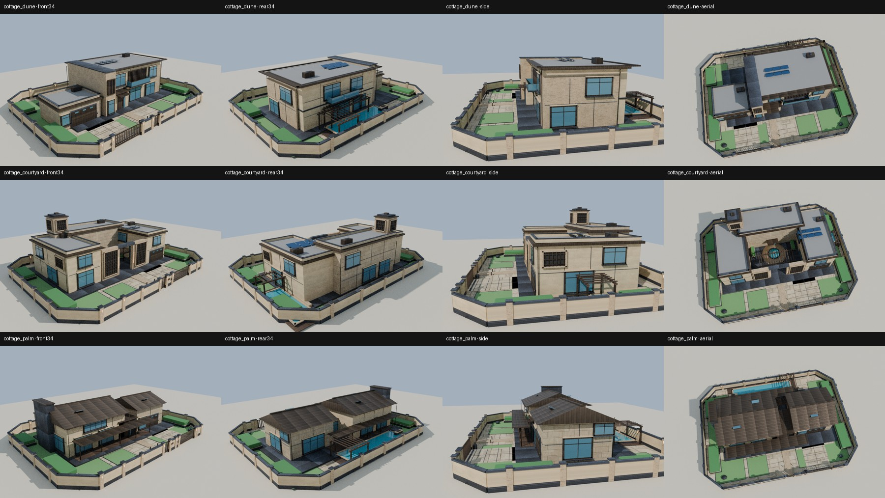
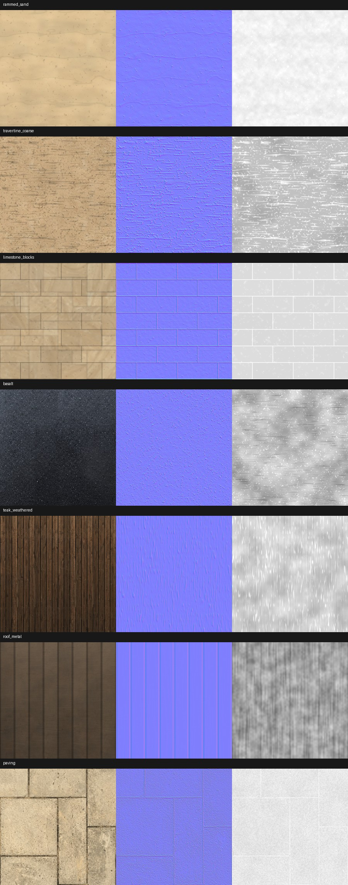

# Коттеджи-усадьбы Острова Паруса

## Статус

Все три усадьбы утверждены пользователем и интегрированы в игру в
Native Alpha **0.2.39**: модели и PBR-текстуры подключены в Godot,
расставлены на Острове Паруса и попадают в Android/Desktop-сборки.

## Общий принцип

Building Model No.1 занимает всего 19,20 × 15,24 м и не имеет настоящей
приватной территории. Новые Building Models No.10–12 спроектированы как
полные усадьбы фиксированного размера **35,96 × 27,0 м**:

- скошенный по углам участок под кривые берега и кольцевую дорогу;
- каменная стена высотой около 2,1 м с пилястрами, цоколем и подсветкой;
- закрытые откатные автомобильные ворота и отдельная калитка;
- домофон, адресная табличка, мотор ворот и дренажная решётка;
- мощёный подъезд, разворотный двор и закрытый гараж;
- входной портал, террасы, перголы, бассейн и наружная кухня там, где
  это позволяет план;
- минеральные пустынные посадки, отдельные газонные комнаты, кадки,
  живые изгороди и каменные валуны.

**Интерьеров нет.** За reflective glass находится только тёмная внешняя
подложка и, у части окон, опущенная штора/жалюзи. Комнат, лестниц,
мебели и внутренних перегородок в моделях нет.

## No.10 — «Дюна» (`cottage_dune.glb`)

- Размер участка: 35,96 × 27,01 м; высота 8,90 м; 14 568 треугольников.
- Горизонтальный дубайский desert modern: двухэтажный песочный объём,
  травертиновая «пластина»-солнцезащита, отдельный гаражный блок и
  бронзовая рамка увеличенного свеса плоской крыши.
- Верхний этаж закрыт тиковым реечным экраном, спереди и сзади —
  балконы со стеклянным ограждением.
- На крыше солнечные панели и экранированный HVAC-блок; сзади бассейн
  12,5 × 3,7 м, пергола и тиковая дека.

## No.11 — «Машрабия» (`cottage_courtyard.glb`)

- Размер участка: 35,96 × 26,99 м; высота 11,64 м; 16 692 треугольника.
- U-образный дом вокруг открытого двора: два крыла, задний корпус,
  входной портал и две каменные панели с современной машрабией.
- Современная кубическая ветровая башня barjeel с экранированной
  короной и ступенчатым бронзовым завершением.
- Во дворе круглый фонтан, мощёный медальон, пергола и кадки; вдоль
  восточной стены узкий lap-pool 3,15 × 9,6 м с маленькой кабаной.

## No.12 — «Пальмовый павильон» (`cottage_palm.glb`)

- Размер участка: 35,96 × 27,01 м; высота 8,81 м; 13 544 треугольника.
- Два курортных павильона со стоячим фальцем металлических двускатных
  крыш, соединённые тёмным остеклённым звеном.
- Глубокие передняя и задняя веранды на тонких бронзовых колоннах,
  открытые стропильные хвосты, водосточные желоба и skylight-окна.
- Базальтовая пластина камина, наружный очаг с дровяной нишей,
  бассейн 15,5 × 3,9 м и задняя пергола.

## Новые PBR-материалы

Генератор: `scripts/generate_cottage_textures.py`. Каждый набор —
1024×1024 albedo, tangent-space normal и отдельная roughness-карта:

| Материал | Характер | Средняя roughness |
| --- | --- | ---: |
| `cottage_rammed_sand` | широкие волнистые слои утрамбованного песка, поры и выветривание | ≈0,95 |
| `cottage_travertine_coarse` | крупный пористый травертин с горизонтальными порами и прожилками | ≈0,78 |
| `cottage_limestone_blocks` | крупная известняковая кладка 600–900 мм, сколы и солевые пятна | ≈0,87 |
| `cottage_basalt` | тёмный везикулярный базальт с матовыми и отполированными зонами | ≈0,74 |
| `cottage_teak_weathered` | выгоревший серо-коричневый тик, трещины и сухие волокна | ≈0,81 |
| `cottage_roof_metal` | стоячий фальц, окисление и потёртости швов | ≈0,63 |
| `cottage_paving` | тёплое крупноформатное каменное мощение | ≈0,90 |

В Blender материалы также имеют физически разные базовые roughness:
песок 0,97, известняк 0,93, травертин 0,84, базальт 0,78, тик 0,86,
кровельный металл 0,52 и бронза 0,38. В Godot 0.2.39 подключены именно
roughness-карты: `_material()` получил опциональную roughness-текстуру
(красный канал), а скаляр остался только калибровочным множителем —
1,0 для камня/песка/тика/мощения, 0,82 для кровельного металла и
0,60 для бронзы.

## Игровое размещение (0.2.39)

Стоят **три усадьбы**, а не четыре одинаковых угла. Первоначальные
кардинальные центры `(1147, 19)`, `(1231, 19)` и `(1231, 141)` не
прошли плотный аудит по runtime-террейну: перепад высоты внутри
участка достигал 0,83–1,29 м, и плоская усадьба висела бы внешним
углом. Финальная схема — диагональная, фасадом (`+Z`) к центру
кольца `(1188, 80)`:

- северо-запад: «Дюна», центр `(1158, 18)`, `rotY = 0,4507`;
- северо-восток: «Машрабия», центр `(1218, 18)`, `rotY = -0,4507`;
- юго-восток: «Пальмовый павильон», центр `(1218, 142)`,
  `rotY = -2,6909`;
- юго-западный угол — открытая смотровая терраса: газон 30 × 21 м и
  третья островная пергола в точке `(1145, 141)`, без четвёртой копии.

Полный повёрнутый прямоугольник каждого участка отстоит от осевой
линии кольца минимум на ≈9,0 м (≥4,4 м от асфальта и вне полосы
приподнятых тротуарных плит), остаётся внутри променада, а перепад
террейна внутри участка — 0,46–0,60 м. Оригин модели ставится на
максимальную sampled высоту участка, остаток уклона поглощает
низкий базальтовый retaining-подиум из трёх плит под планом участка.

Ворота статичные и закрытые. Коллайдеры повторяют архитектуру:
8 сегментов периметра (фасад с воротами, тыл, бока и четыре скоса)
плюс отдельные объёмы дома, гаража/крыльев и бассейна — всего
13–15 боксов на усадьбу вместо одного невидимого куба 36 × 27 м.
В передний сад каждой усадьбы, напротив ворот, ставится одна
детализированная игровая пальма (`palm_date`/`palm_royal`).

## Производительность

Треугольный бюджет одного участка сопоставим с существующей виллой
No.1 (17 232 треугольника), хотя территория почти втрое больше по
площади. В Blender это 535–617 объектов, но Godot уже объединяет части
по 16–17 семантическим материалам в MultiMesh. В игре детальный
диапазон — 240 м (мелкий ландшафт и свет уходят раньше, на
150–210 м), дальше силуэт держат простые far-proxy объёмы участка,
дома, крыльев и ветровой башни.

## Ограничения превью

Blender-превью использует те же PBR-карты, но газон, стекло и вода в
нём упрощены; финальный вид нужно проверять уже игровыми скриншотами
Godot. Пальмы специально не встроены в GLB: в игре должны ставиться
существующие детализированные `palm_date.glb` и `palm_royal.glb`.
